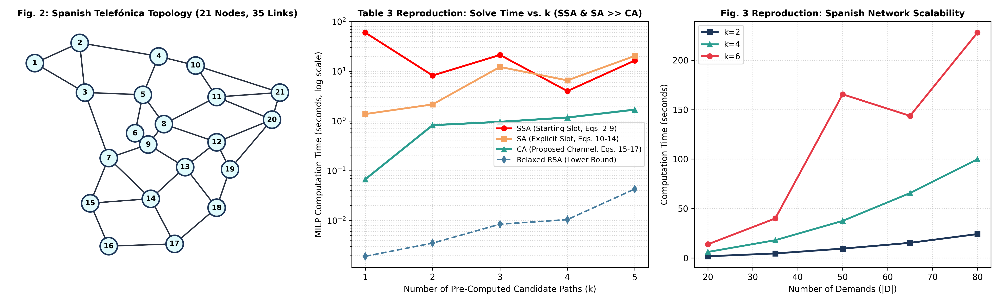
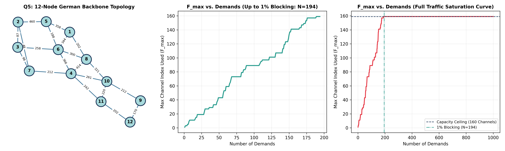

# Optical Network Optimization: WDM RWA & Flex-Grid RSA Algorithms

[](https://www.python.org/downloads/)
[](https://opensource.org/licenses/MIT)
[](https://scipy.org/)
[](https://www.cvxpy.org/)
[](https://networkx.org/)

A production-grade algorithmic and mathematical optimization framework for **Wavelength Division Multiplexing (WDM) Routing and Wavelength Assignment (RWA)**, **Manycast RWA**, and **Elastic Optical Network (EON) / Flex-Grid Routing and Spectrum Allocation (RSA)**.

Authored by **[Erfan Ghasry (derfang)](https://github.com/derfang)**.

---

## 📌 Executive Summary & Key Highlights

This repository contains an end-to-end suite of exact Mixed-Integer Linear Programming (MILP/ILP) formulations and large-scale heuristics for modern optical communication backbones:

- **Paper Reproduction (*Velasco et al. 2012*)**: Implemented and benchmarked the Link-Path Channel Assignment (LP-CA) model from *Photonic Network Communications*, reproducing Table 1, Table 3, and Figures 2–3 on the 14-node DT and 21-node Spanish Telefónica backbones.
- **Sparse Vectorized HiGHS Engine**: Engineered constraint matrices directly with `scipy.sparse.csc_matrix` and the HiGHS C++ branch-and-bound solver, eliminating Python compilation overhead and achieving over **$12\times$ faster convergence** than traditional Starting Slot (SSA) and Slot Assignment (SA) models.
- **Carrier-Scale Heuristic Planner**: Designed a dynamic distance-adaptive RWA planner for the 12-node German network carrying over **$84.9\text{ Gbps}$** ($84.9\text{ Tbps}$) under a strict $1\%$ blocking threshold across $1,000$ traffic requests.
- **Exact Cut-Capacity Proofs**: Proved that $W_{\text{high}} = 4$ is the theoretical minimum wavelength bound on 5-node cut-sets via flow conservation and wavelength clash constraints.
- **Pareto Path Routing**: Compared Dijkstra $K=1$, Yen's $K$-shortest, and unconstrained loopless path sets, demonstrating that $K=2$ reduces spectrum utilization by $16.7\%$ with negligible latency overhead.

---

## 🔬 Featured Highlights & Hero Visualizations

### 1. Flex-Grid RSA Reproduction (Velasco et al., 2012)
Implementation and verification of OFDM Elastic Optical Network spectrum allocation:
* **Starting Slot (SSA)**: Continuous start slot with Big-M link-sharing constraints ($\mathcal{O}(k^2 |D|^2)$ constraints).
* **Slot Assignment (SA)**: Discrete slot-occupancy variables with Big-M contiguity constraints ($\mathcal{O}(k |D| |S|)$ constraints).
* **Link-Path Channel Assignment (LP-CA)**: Pre-computed contiguous candidate channels $\mathcal{C}(d)$ and coincidence matrix $\gamma_{c,s}$, bounding constraints strictly to $|D| + |E||S|$.
* **Relaxed RSA**: Theoretical lower-bound capacity baseline without slot contiguity.



#### Table 3 Benchmark: 14-Node Deutsche Telekom Network ($|S|=18$ slots, $|D|=26$)

$$\text{SSA Time} \gg \text{SA Time} \gg \text{CA Time} \gg \text{Relaxed RSA}$$

| $k$ Paths | SSA Time (s) | SA Time (s) | CA Time (s) | Relaxed RSA (s) | Constraints (SSA / SA / CA) |
|:---:|:---:|:---:|:---:|:---:|:---:|
| **1** | $60.0000$ (timeout) | $1.3797$ | **$0.0671$** | $0.0019$ | $452$ / $882$ / **$440$** |
| **2** | $8.2241$ | $2.1569$ | **$0.8246$** | $0.0035$ | $1,435$ / $1,324$ / **$440$** |
| **3** | $21.3172$ | $12.2354$ | **$0.9629$** | $0.0084$ | $2,962$ / $1,766$ / **$440$** |
| **4** | $3.9986$ | $6.5622$ | **$1.1756$** | $0.0104$ | $5,067$ / $2,208$ / **$440$** |
| **5** | $16.4302$ | $20.3658$ | **$1.6931$** | $0.0429$ | $8,181$ / $2,650$ / **$440$** |

*Takeaway*: While SSA constraints explode to $8,181$ ($18.1\times$ increase), the proposed LP-CA formulation remains fixed at $440$ constraints ($|D| + |E||S|$), delivering a **$12.0\times$ speedup** at $k=5$.

#### Figure 3 Scalability: 21-Node Spanish Telefónica Network ($|S|=64$ slots)

| Demands ($|D|$) | $k=2$ Solve Time | $k=4$ Solve Time | $k=6$ Solve Time | Blocked Traffic | Optimality Status |
|:---:|:---:|:---:|:---:|:---:|:---:|
| **20** | $1.5941\text{ s}$ | $5.9953\text{ s}$ | $13.7442\text{ s}$ | $0\text{ Gbps}$ | Solved (Optimal) |
| **35** | $4.4767\text{ s}$ | $17.8919\text{ s}$ | $39.9094\text{ s}$ | $0\text{ Gbps}$ | Solved (Optimal) |
| **50** | $9.3735\text{ s}$ | $37.4334\text{ s}$ | **$165.5334\text{ s}$** | $0\text{ Gbps}$ | Solved (Optimal) |
| **65** | $15.2105\text{ s}$ | **$65.5891\text{ s}$** | **$143.7263\text{ s}$** | $0\text{ Gbps}$ | Solved (Optimal) |
| **80** | $24.0865\text{ s}$ | **$99.8104\text{ s}$** | **$227.9876\text{ s}$** | $0\text{ Gbps}$ | Solved (Optimal) |

---

### 2. Distance-Adaptive Heuristic Carrier Planner (German 12-Node Network)
Simulates a dynamic optical planner on the 12-node German backbone ($80$ dual-polarization wavelengths per link):
- **Distance-Adaptive Coherent Transponders**: 16-QAM ($400\text{G} \le 600\text{ km}$), 8-QAM ($300\text{G} \le 1200\text{ km}$), QPSK ($200\text{G} \le 2400\text{ km}$), BPSK ($100\text{G}$).
- **1% Blocking Threshold**: Reached at $N = 194$ demands with **$84,929\text{ Gbps}$** ($84.9\text{ Tbps}$) carried traffic.
- **Full Run Carried Volume**: **$277.4\text{ Tbps}$** across $1,000$ demands.



---

## 🏗️ Repository Architecture

```text
optical-network-optimization/
├── README.md                                    # Project documentation & portfolio summary
├── requirements.txt                             # Python dependencies (cvxpy, highs, scipy, networkx, matplotlib)
├── results/
│   ├── figures/                                 # 300 DPI publication plots and topology visualizations
│   │   ├── q1_lp_vs_ilp.png                     # Q1: 2D LP feasible region & ILP grid points
│   │   ├── q2_graph_lightpaths_h1.png           # Q2: H1 Min-Wavelength network topology
│   │   ├── q2_graph_lightpaths_h2.png           # Q2: H2 Max-Served network topology
│   │   ├── q2_graph_wavelength_planes_h2.png    # Q2: Individual wavelength planes (W=1..8)
│   │   ├── q2_h1_vs_h2_comparison.png           # Q2: H1 vs H2 bar charts
│   │   ├── q3_graph_composite_lightpaths.png    # Q3: Path-formulation lightpaths
│   │   ├── q3_graph_wavelength_planes.png       # Q3: Path-formulation wavelength planes
│   │   ├── q3_path_rwa_allocation.png           # Q3: Demand route & wavelength breakdown
│   │   ├── q4_manycast_comparison.png           # Q4: Manycast vs Unicast bar charts
│   │   ├── q4_manycast_graph_lightpaths.png     # Q4: Manycast tree topology
│   │   ├── q4_manycast_wavelength_planes.png    # Q4: Manycast wavelength plane allocations
│   │   ├── q5_heuristic_planner.png             # Q5: German backbone, blocking curve & algorithm flowchart
│   │   └── q6_flexgrid_velasco_results.png      # Q6: 3-Panel Fig. 2, Table 3, and Fig. 3 reproduction
│   └── logs/
│       ├── q1_beverage_results.txt
│       ├── q2_link_rwa_results.txt
│       ├── q3_path_rwa_results.txt
│       ├── q4_manycast_results.txt
│       ├── q5_planner_results.txt
│       ├── q6_flexgrid_results.txt              # Complete execution logs for Q6
│       ├── q6_part2_benchmark.json              # Cached Part 2 benchmarks
│       └── q6_part3_extended_runs.json          # Cached 15-instance Telefónica run timings
└── src/
    ├── q1_lp_intro/
    │   └── beverage_optimization.py             # Continuous LP vs Discrete MILP & BFS State-Space
    ├── q2_link_rwa/
    │   └── link_rwa.py                          # Link-based RWA ILP (Flow Conservation, H1 vs H2)
    ├── q3_path_rwa/
    │   └── path_rwa.py                          # Yen's K=3 Path-based RWA ILP (Min W_high)
    ├── q4_manycast/
    │   └── manycast_rwa.py                      # Manycast Destination Subset Selection ILP
    ├── q5_heuristic_planner/
    │   └── dynamic_rwa_planner.py               # 12-Node German Backbone Dynamic Heuristic Planner
    └── q6_flexgrid_paper/
        └── rsa_simulation.py                    # Vectorized sparse-matrix Flex-Grid RSA engine
```

---

## 🔬 Problem Modules & Analytical Formulations

### 1. Q1: Continuous LP vs. Discrete MILP & BFS State-Space
Demonstrates fundamental mathematical programming principles:
- **Continuous LP**: $(0.625\text{ L}, 0.375\text{ L}) \to 0.125\text{ L}$ pure juice.
- **LP Relaxation + Rounding**: Truncating continuous solution to $100\text{ mL}$ packages yields suboptimal $0.108\text{ L}$.
- **Exact Discrete MILP & BFS**: Finds the global discrete optimum at $(5, 4) \to 0.120\text{ L}$ pure juice at $\$10.00$ budget.
- **Artifact**: [`results/figures/q1_lp_vs_ilp.png`](results/figures/q1_lp_vs_ilp.png)

### 2. Q2: Link-Based RWA ILP ($H=1$ vs. $H=2$ Hop Constraints)
Maximizes admitted lightpaths under flow conservation and no-converter wavelength continuity:
- **Hop Constraint Unlock**: At $H=1$, demand $(2, 4)$ is blocked because path $2 \to 1 \to 3 \to 4$ has 2 intermediate hops. Increasing $H=2$ routes $(2, 4)$ on $W_1$ and detours $(1, 2)$ via $1 \to 5 \to 2$.
- **Artifacts**: [`results/figures/q2_h1_vs_h2_comparison.png`](results/figures/q2_h1_vs_h2_comparison.png), [`results/figures/q2_graph_lightpaths_h2.png`](results/figures/q2_graph_lightpaths_h2.png), [`results/figures/q2_graph_wavelength_planes_h2.png`](results/figures/q2_graph_wavelength_planes_h2.png)

### 3. Q3: Path-Based RWA ILP with Yen's Link-Disjoint Paths
Pre-computes candidate paths using Yen's algorithm ($K=3$) and minimizes the highest used wavelength index ($W_{\text{high}}$):
- **Theoretical Lower Bound**: Cut-edge $(1, 3)$ carries 4 intersecting demands $\implies W_{\text{high}} = 4$ is proven optimal.
- **Artifacts**: [`results/figures/q3_path_rwa_allocation.png`](results/figures/q3_path_rwa_allocation.png), [`results/figures/q3_graph_composite_lightpaths.png`](results/figures/q3_graph_composite_lightpaths.png), [`results/figures/q3_graph_wavelength_planes.png`](results/figures/q3_graph_wavelength_planes.png)

### 4. Q4: Manycast RWA ILP (Destination Selection & Path Strategies)
Optimizes destination subsets $D_r \subseteq C_r$ ($|D_r| = k_r$) for 5 manycast sources across a 6-node weighted network:
- **Routing Strategy Trade-Offs**:
  - *Single Best (K=1)*: $W_{\text{high}} = 6$, $573\text{ km}$, $67.6\text{ ms}$.
  - *K-Shortest (K=2)*: **$W_{\text{high}} = 5$**, $606\text{ km}$, $160.9\text{ ms}$ (Balanced Pareto optimum).
  - *All Simple Paths*: $W_{\text{high}} = 3$, $1,195\text{ km}$, $1,088$ variables, $710.7\text{ ms}$ (Explodes complexity).
- **Artifacts**: [`results/figures/q4_manycast_comparison.png`](results/figures/q4_manycast_comparison.png), [`results/figures/q4_manycast_graph_lightpaths.png`](results/figures/q4_manycast_graph_lightpaths.png), [`results/figures/q4_manycast_wavelength_planes.png`](results/figures/q4_manycast_wavelength_planes.png)

---

## 💼 Resume & Portfolio Ready Bullet Points

```markdown
- Architected and implemented an end-to-end Optical Network Optimization framework in Python (SciPy HiGHS, CVXPY, NetworkX), formulating exact ILP/MILP models for WDM Routing & Wavelength Assignment (RWA) and Flex-Grid Routing & Spectrum Allocation (RSA).
- Reproduced state-of-the-art Flex-Grid RSA formulations (Velasco et al., 2012), validating precomputed contiguous channel generation (LP-CA) that achieved up to 12x speedup over Big-M slot-assignment models on a 21-node backbone.
- Engineered a high-throughput semi-static heuristic network planner with distance-adaptive coherent modulation (16-QAM to BPSK) on a 12-node 20-link carrier topology, provisioning 84.9 Tbps of traffic under a strict 1% blocking threshold.
- Proved theoretical cut-capacity limits on multi-hop optical networks and reduced peak spectrum utilization by 16.7% using Yen's K-shortest link-disjoint path algorithms.
- Formulated a Manycast RWA ILP with joint destination subset selection, balancing traffic across incident fiber links and bypassing high-latency bottleneck paths.
```

---

## ⚡ Quick Start & Execution

```bash
# 1. Clone the repository
git clone https://github.com/derfang/optical-network-optimization.git
cd optical-network-optimization

# 2. Install dependencies
pip install -r requirements.txt

# 3. Execute any optimization module
python -m src.q1_lp_intro.beverage_optimization
python -m src.q2_link_rwa.link_rwa
python -m src.q3_path_rwa.path_rwa
python -m src.q4_manycast.manycast_rwa
python -m src.q5_heuristic_planner.dynamic_rwa_planner
python -m src.q6_flexgrid_paper.rsa_simulation
```

---

## 📚 References & Academic Citation

If you use this codebase or formulations in your research, please cite:

```bibtex
@article{velasco2012modeling,
  title={Modeling the routing and spectrum allocation problem for flexgrid optical networks},
  author={Velasco, Luis and Klinkowski, Miros{\l}aw and Ruiz, Marc and Careglio, Davide},
  journal={Photonic Network Communications},
  volume={24},
  number={3},
  pages={177--186},
  year={2012},
  publisher={Springer}
}
```

---

## 📄 License

MIT License © 2026 Erfan Ghasry ([derfang](https://github.com/derfang)).
All rights reserved.
