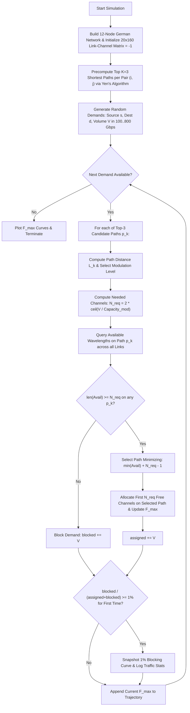

# Mathematical Formulations: Optical Network Optimization

This document contains the formal mathematical derivations, sets, parameters, decision variables, objectives, and constraints for all linear and mixed-integer linear programming formulations in the project.

---

## Question 1: Beverage Production Optimization (LP vs. MILP)

### Problem Description
A beverage blending optimization problem used as an introductory foundation for mathematical programming, demonstrating continuous Linear Programming (LP), LP relaxation floor-rounding suboptimality, state-space Breadth-First Search (BFS), and exact Mixed-Integer Linear Programming (MILP).

### 1. Part (a): Continuous Linear Program (LP)
Find the optimal blend of Drink $A$ and Drink $B$ in liters to maximize the total volume of pure fruit juice under budget and volume capacity limits.

#### Decision Variables
- $x_A \ge 0$: Volume of Drink $A$ in liters.
- $x_B \ge 0$: Volume of Drink $B$ in liters.

#### Objective Function
Maximize total pure fruit juice ($8\%$ in Drink $A$, $20\%$ in Drink $B$):
$$\max \quad Z_{\text{LP}} = 0.08 x_A + 0.20 x_B$$

#### Constraints
1. **Budget Limitation** (\$4/L for $A$, \$20/L for $B$, total budget \$10):
   $$4.0 x_A + 20.0 x_B \le 10.0$$
2. **Container Capacity** (Maximum container volume of 1.0 L):
   $$x_A + x_B \le 1.0$$
3. **Non-negativity**:
   $$x_A \ge 0, \quad x_B \ge 0$$

---

### 2. Part (b): Discrete Integer Linear Program (100 mL Units)
When drinks are sold exclusively in discrete 100 mL packages, let $a, b \in \mathbb{Z}^+$ denote the number of 100 mL packages of Drink $A$ and Drink $B$ respectively ($x_A = a/10$, $x_B = b/10$).

#### Decision Variables
- $a \in \mathbb{Z}^+$: Number of 100 mL packs of Drink $A$.
- $b \in \mathbb{Z}^+$: Number of 100 mL packs of Drink $B$.

#### Objective Function
$$\max \quad Z_{\text{ILP}} = \frac{0.08 a + 0.20 b}{10}$$

#### Constraints
1. **Discrete Budget Constraint** (\$0.40/pack for $A$, \$2.00/pack for $B$):
   $$0.4 a + 2.0 b \le 10.0$$
2. **Discrete Container Capacity** (At most 10 packs of 100 mL = 1.0 L):
   $$a + b \le 10$$
3. **Product Inclusion**:
   $$a \ge 1, \quad b \ge 1, \quad a, b \in \mathbb{Z}$$

#### Comparison of Solution Approaches
- **Continuous LP Relaxation + Floor Rounding**:
  Solving continuous LP gives $(x_A^*, x_B^*) = (0.625\text{ L}, 0.375\text{ L})$. Floor rounding to 100 mL packages yields $a = \lfloor 6.25 \rfloor = 6$ ($0.60$ L) and $b = \lfloor 3.75 \rfloor = 3$ ($0.30$ L), delivering **$0.108\text{ L}$** pure juice for $\$8.40$. This highlights the suboptimality of naive heuristic rounding.
- **BFS State-Space Search & Exact MILP Solver**:
  Exploring the discrete integer lattice finds the global discrete optimum at $(a^*, b^*) = (5, 4)$, representing $0.50\text{ L}$ Drink $A$ and $0.40\text{ L}$ Drink $B$, achieving **$0.120\text{ L}$** pure juice at exactly $\$10.00$.

---

## Question 2: Link-based ILP for RWA (Max Served Requests)

### Problem Description
Given a physical optical topology graph $G = (V, E)$ and a static traffic demand matrix $A_{|V| \times |V|}$, route and assign wavelengths to lightpath requests without wavelength converters (wavelength continuity constraint) to maximize total served traffic requests, subject to a maximum hop limit $H$.

### Sets and Parameters
- $V$: Set of optical network nodes ($|V| = 5$).
- $E$: Set of physical fiber links: $E = \{(1, 2), (1, 3), (1, 5), (2, 5), (3, 4)\}$.
- $A$: Set of directed fiber arcs: $A = \{(u, v), (v, u) \mid \{u, v\} \in E\}$.
- $W$: Set of available optical wavelengths per link: $W = \{1, 2, \dots, |W|\}$.
- $K$: Set of active connection requests $(s, d)$ where $A[s, d] = 1$.
- $H$: Maximum allowable hop count parameter.
  - *Intermediate Hops Interpretation*: Path contains at most $H$ intermediate nodes $\implies \text{max\_links} = H + 1$.
  - *Total Links Interpretation*: Path traverses at most $H$ physical links $\implies \text{max\_links} = H$.

### Decision Variables
- $y_{s, d, w} \in \{0, 1\}$: Binary variable equal to $1$ if connection request $(s, d) \in K$ is served on wavelength $w \in W$; $0$ otherwise.
- $f_{s, d, w}^{u, v} \in \{0, 1\}$: Binary routing variable equal to $1$ if lightpath $(s, d)$ on wavelength $w$ traverses directed arc $(u, v) \in A$; $0$ otherwise.

### Objective Function
Maximize the total number of successfully established lightpath requests:
$$\max \quad \sum_{(s, d) \in K} \sum_{w \in W} y_{s, d, w}$$

### Constraints

1. **Single Wavelength Allocation per Demand**:
   Each admitted connection request is assigned to at most one optical channel:
   $$\sum_{w \in W} y_{s, d, w} \le 1, \quad \forall (s, d) \in K$$

2. **Flow Conservation & Wavelength Continuity**:
   Ensures end-to-end lightpath continuity on the same wavelength $w$ across intermediate transparent optical nodes (no wavelength conversion):
   $$\sum_{v: (u, v) \in A} f_{s, d, w}^{u, v} - \sum_{v: (v, u) \in A} f_{s, d, w}^{v, u} = \begin{cases} 
   y_{s, d, w}, & u = s \\ 
   -y_{s, d, w}, & u = d \\ 
   0, & \forall u \in V \setminus \{s, d\} 
   \end{cases} \quad \forall (s, d) \in K, \forall w \in W$$
   Additionally, inflow at source $s$ and outflow at destination $d$ are strictly zero:
   $$\sum_{v: (v, s) \in A} f_{s, d, w}^{v, s} = 0, \quad \sum_{v: (d, v) \in A} f_{s, d, w}^{d, v} = 0, \quad \forall (s, d) \in K, \forall w \in W$$

3. **Subtour & Self-Loop Elimination**:
   Precludes cyclic flow across non-terminal nodes:
   $$\sum_{v: (u, v) \in A} f_{s, d, w}^{u, v} \le y_{s, d, w}, \quad \forall u \in V \setminus \{d\}, \forall (s, d) \in K, \forall w \in W$$

4. **Maximum Hop Bound Constraint**:
   Constrains path length according to $H$:
   $$\sum_{(u, v) \in A} f_{s, d, w}^{u, v} \le L_{\max} \cdot y_{s, d, w}, \quad \forall (s, d) \in K, \forall w \in W$$
   where $L_{\max} = H + 1$ (for intermediate node limits) or $L_{\max} = H$ (for total link limits).

5. **Wavelength Clash & Capacity Constraint**:
   Two lightpaths sharing the same fiber cannot be assigned the same wavelength:
   - *Directed Arcs*:
     $$\sum_{(s, d) \in K} f_{s, d, w}^{u, v} \le 1, \quad \forall (u, v) \in A, \forall w \in W$$
   - *Undirected Edges*:
     $$\sum_{(s, d) \in K} \left( f_{s, d, w}^{u, v} + f_{s, d, w}^{v, u} \right) \le 1, \quad \forall \{u, v\} \in E, \forall w \in W$$

---

## Question 3: Path-based ILP for RWA (Min Max Wavelength Index)

### Problem Description
Transitioning from link-flow formulation to path-based formulation. Candidate paths are precomputed using Yen's $K$-shortest link-disjoint path algorithm ($K=3$) for every traffic demand $(s, d)$. The objective is to assign exactly one lightpath and wavelength to each demand such that the maximum wavelength index used in the network ($W_{\text{high}}$) is minimized.

### Sets and Parameters
- $\mathcal{E}$: Set of physical undirected optical fiber links ($|\mathcal{E}| = 5$).
- $\mathcal{D}$: Set of traffic demands $(s, d)$ where $t_{sd} = 1$.
- $\mathcal{P}_{sd} = \{p_{sd, 1}, p_{sd, 2}, \dots\}$: Set of precomputed link-disjoint candidate paths for demand $(s, d)$ ($|\mathcal{P}_{sd}| \le K = 3$).
- $\mathcal{W} = \{1, 2, \dots, W_{\max}\}$: Candidate wavelength index set.
- $t_{sd}$: Traffic demand volume for $(s, d)$ (here, $t_{sd} = 1$).
- $X_{sd, k}^l \in \{0, 1\}$: Path-link incidence parameter, equal to $1$ if candidate path $p_{sd, k}$ traverses physical link $l \in \mathcal{E}$; $0$ otherwise.

### Decision Variables
- $c_{sd, k}^w \in \{0, 1\}$: Binary variable indicating whether demand $(s, d) \in \mathcal{D}$ is routed along candidate path $p_{sd, k}$ on wavelength index $w \in \mathcal{W}$.
- $W_{\text{high}} \in \mathbb{Z}^+$: Integer variable representing the maximum wavelength index utilized across the entire optical network.

### Objective Function
Minimize the maximum wavelength index:
$$\min \quad W_{\text{high}}$$

### Constraints

1. **Demand Satisfaction**:
   Each demand $(s, d) \in \mathcal{D}$ must be provisioned with its required number of lightpaths:
   $$\sum_{k: p_{sd, k} \in \mathcal{P}_{sd}} \sum_{w \in \mathcal{W}} c_{sd, k}^w = t_{sd}, \quad \forall (s, d) \in \mathcal{D}$$

2. **Link Capacity / Wavelength Clash**:
   No two lightpaths traversing the same physical link $l \in \mathcal{E}$ may share the same wavelength index $w$:
   $$\sum_{(s, d) \in \mathcal{D}} \sum_{k: p_{sd, k} \in \mathcal{P}_{sd}} X_{sd, k}^l \cdot c_{sd, k}^w \le 1, \quad \forall l \in \mathcal{E}, \forall w \in \mathcal{W}$$

3. **Maximum Wavelength Index Bounding**:
   $W_{\text{high}}$ must be greater than or equal to the wavelength index of every established lightpath:
   $$W_{\text{high}} \ge w \cdot c_{sd, k}^w, \quad \forall (s, d) \in \mathcal{D}, \forall k: p_{sd, k} \in \mathcal{P}_{sd}, \forall w \in \mathcal{W}$$
   $$W_{\text{high}} \ge 0$$

---

## Question 4: Manycast RWA ILP

### Problem Description
In Manycast optical communication (common in data center synchronization, cloud storage replication, and distributed content delivery), a source node $s_r$ must communicate with any subset $D_r \subseteq C_r$ of $k_r$ candidate destination nodes ($|D_r| = k_r$). For each selected destination $d \in D_r$, a traffic volume of $\tau_r$ lightpaths must be provisioned. The optimization problem jointly selects the destination nodes, calculates the physical routes, and assigns wavelengths to minimize the maximum utilized wavelength index and total physical transmission distance.

### Sets and Parameters
- $V$: Set of optical nodes ($V = \{1, 2, \dots, 6\}$).
- $\mathcal{E}$: Set of physical fiber links with physical distance weights $L_e$ (km).
- $\mathcal{R}$: Set of manycast requests $r = (s_r, C_r, k_r, \tau_r)$, where:
  - $s_r$: Source node.
  - $C_r \subset V$: Set of candidate destination nodes.
  - $k_r \le |C_r|$: Number of destinations that must be selected.
  - $\tau_r$: Number of lightpaths required between $s_r$ and each chosen destination $d \in D_r$.
- $\mathcal{P}_{r, d} = \{p_{r, d, 1}, p_{r, d, 2}, \dots\}$: Set of precomputed $K$-shortest physical paths between $s_r$ and candidate destination $d$.
- $\mathcal{W} = \{1, 2, \dots, W_{\max}\}$: Candidate optical wavelength channels.
- $X_{r, d, m}^e \in \{0, 1\}$: Path-edge incidence parameter ($1$ if path $p_{r, d, m}$ traverses link $e \in \mathcal{E}$; $0$ otherwise).

### Decision Variables
- $\delta_{r, d} \in \{0, 1\}$: Binary variable equal to $1$ if candidate destination $d \in C_r$ is selected for request $r$; $0$ otherwise.
- $c_{r, d, m}^w \in \{0, 1\}$: Binary routing and wavelength assignment variable indicating whether candidate path $m \in \mathcal{P}_{r, d}$ on wavelength $w \in \mathcal{W}$ is established for pair $(s_r, d)$.
- $U^w \in \{0, 1\}$: Binary activation variable equal to $1$ if wavelength index $w$ is active anywhere in the optical network.
- $W_{\text{high}} \in \mathbb{Z}^+$: Integer variable denoting the highest wavelength index utilized.

### Objective Function
Minimize the weighted sum of active wavelength indices (with a secondary tie-breaker $\epsilon \ll 1$ minimizing total physical distance):
$$\min \quad \sum_{w \in \mathcal{W}} w \cdot U^w + \epsilon \sum_{r \in \mathcal{R}} \sum_{d \in C_r} \sum_{m \in \mathcal{P}_{r, d}} \sum_{w \in \mathcal{W}} \text{dist}(p_{r, d, m}) \cdot c_{r, d, m}^w$$

### Constraints

1. **Manycast Destination Cardinality**:
   For each request $r$, exactly $k_r$ destinations from candidate set $C_r$ must be chosen:
   $$\sum_{d \in C_r} \delta_{r, d} = k_r, \quad \forall r \in \mathcal{R}$$

2. **Traffic Demand Satisfaction**:
   If candidate destination $d$ is selected ($\delta_{r, d} = 1$), exactly $\tau_r$ lightpaths must be provisioned across the candidate paths and wavelengths; if not selected, zero lightpaths are provisioned:
   $$\sum_{m: p_{r, d, m} \in \mathcal{P}_{r, d}} \sum_{w \in \mathcal{W}} c_{r, d, m}^w = \tau_r \cdot \delta_{r, d}, \quad \forall r \in \mathcal{R}, \forall d \in C_r$$

3. **Wavelength Clash / Link Capacity**:
   On each physical link $e \in \mathcal{E}$, at most one lightpath can operate on wavelength $w$:
   $$\sum_{r \in \mathcal{R}} \sum_{d \in C_r} \sum_{m: p_{r, d, m} \in \mathcal{P}_{r, d}} X_{r, d, m}^e \cdot c_{r, d, m}^w \le 1, \quad \forall e \in \mathcal{E}, \forall w \in \mathcal{W}$$

4. **Wavelength Index Activation & Upper Bound**:
   Couples lightpath allocations to the global wavelength indicators:
   $$U^w \ge c_{r, d, m}^w, \quad \forall r \in \mathcal{R}, \forall d \in C_r, \forall m \in \mathcal{P}_{r, d}, \forall w \in \mathcal{W}$$
   $$W_{\text{high}} \ge w \cdot U^w, \quad \forall w \in \mathcal{W}$$

### Path Generation Strategy Comparison
The problem compares three routing generation strategies:
1. **Single Best Shortest Path ($K = 1$)**: Uses only Dijkstra shortest physical paths. Minimizes latency ($573\text{ km}$), but cannot avoid bottleneck links, driving up spectrum index ($W_{\text{high}} = 6$).
2. **Yen's $K$-Shortest Paths ($K = 2 / 3$)**: Evaluates up to $K$ shortest loopless paths. Provides the optimal engineering trade-off ($W_{\text{high}} = 5$, $606\text{ km}$, 160 ms runtime).
3. **All Simple Paths**: Exhaustively generates all loopless paths. Compresses spectrum ($W_{\text{high}} = 3$) at the severe cost of exponential variable explosion ($1088$ variables) and doubled path distance ($1195\text{ km}$).

---

## Question 5: Heuristic Network Planner (Distance-Adaptive RWA)

### Problem Description
Exact ILP formulations become computationally intractable for large-scale optical carrier backbones with hundreds of wavelength channels and thousands of dynamic/static traffic demands. Question 5 implements a semi-static heuristic optical network planner for the 12-Node, 20-Link German Backbone Network with $W = 160$ optical channels per link, using $K$-shortest path routing, distance-adaptive optical modulation formats, and a min-max first-fit channel allocation policy.

### Simulation Architecture & Flowchart

### Distance-Adaptive Modulation Rule (Dual-Polarization Coherent Transponders)
Physical transmission impairments (attenuation, chromatic dispersion, amplified spontaneous emission) limit high-order QAM constellations to shorter physical reach. Using state-of-the-art DP-QAM coherent transponders:
$$\text{Modulation}(L) = \begin{cases} 
\text{16-QAM} & (400\text{ Gbps/channel}), & L \le 600\text{ km} \\
\text{8-QAM} & (300\text{ Gbps/channel}), & 600 < L \le 1200\text{ km} \\
\text{QPSK} & (200\text{ Gbps/channel}), & 1200 < L \le 2400\text{ km} \\
\text{BPSK} & (100\text{ Gbps/channel}), & L > 2400\text{ km}
\end{cases}$$

For a demand with volume $V\text{ Gbps}$, the number of bidirectional wavelength channels required is:
$$N_{\text{channels}} = 2 \times \left\lceil \frac{V}{\text{Capacity}(\text{Modulation})} \right\rceil$$

### Channel Packing Policy: Min-Max First-Fit
Among all candidate paths $p_k \in \mathcal{P}_{sd}$ with sufficient free wavelengths, the heuristic chooses the path that minimizes the upper wavelength index:
$$p^* = \arg\min_{p_k} \left( \min(\mathcal{W}_{\text{avail}}(p_k)) + N_{\text{req}} - 1 \right)$$
This policy packs traffic toward lower-numbered channels, conserving contiguous spectrum blocks and postponing network fragmentation.

### Behavioral Analysis & Findings
1. **Extended Linear Growth Phase ($N = 1 \dots 180$)**:
   - $F_{\max}$ expands linearly as new optical channels are claimed.
   - Zero blocking occurs across the first ~180 demands due to the double channel rate (400G 16-QAM), which reduces required optical channels by half.
2. **1% Blocking Threshold ($N \approx 194 - 220$)**:
   - Reached at **Demand #194**, successfully provisioning **$84,929\text{ Gbps}$** ($\approx 85\text{ Tbps}$) with only **$1,296\text{ Gbps}$** blocked ($1.50\%$).
   - $F_{\max}$ reaches channel index $112$.
3. **Saturation Ceiling ($N > 250$)**:
   - Core links approach the $160$-channel hardware ceiling ($F_{\max} \to 159$).
   - Total carried volume across 1,000 demands climbs to **$277.4\text{ Tbps}$**, demonstrating the spectral efficiency gains of coherent dual-polarization transponders.

---

## Question 6: Flex-Grid RSA / OFDM RMLSA Formulation (Velasco et al., 2012)

### Paper Reference
> **L. Velasco, M. Klinkowski, M. Ruiz, J. Comellas**, *"Modeling the routing and spectrum allocation problem for flexgrid optical networks,"* **Photonic Network Communications**, vol. 24, pp. 177-186, 2012.

### 1. Problem Description & Flex-Grid Paradigm
In Elastic Optical Networks (EONs) / Flex-Grid networks utilizing Optical Frequency Division Multiplexing (OFDM), the fixed 50 GHz WDM grid is replaced with a fine-grained spectrum slice structure (e.g. 12.5 GHz frequency slots). An optical connection request $d \in D$ requiring bandwidth $b_d\text{ Gbps}$ demands a contiguous block of $n_d$ frequency slots ($n_d \in \{1, 2, 4\}$ for 10, 40, 100 Gbps).

The Routing and Spectrum Allocation (RSA) problem requires satisfying two fundamental physical constraints simultaneously:
1. **Spectrum Continuity Constraint**: A lightpath must occupy the identical frequency slots on every link along its routed physical path (in transparent networks without all-optical spectrum converters).
2. **Spectrum Contiguity Constraint**: The $n_d$ frequency slots allocated to demand $d$ must be strictly contiguous (adjacent in the optical spectrum domain).

---

### 2. Pre-computed Contiguous Channel Generation $C(d)$
Rather than relying on complex Big-M integer constraints or quadratic adjacency formulations to enforce slot contiguity, the proposed **Link-Path Channel Assignment (LP-CA)** pre-computes all valid contiguous spectrum channels of width $n_d$ within the total optical slot grid $S = \{1, 2, \dots, |S|\}$:

$$\mathcal{C}(d) = \left\{ [j, j + 1, \dots, j + n_d - 1] \mid j \in \{1, 2, \dots, |S| - n_d + 1\} \right\}$$

The binary incidence parameter $\gamma_{c, s} \in \{0, 1\}$ indicates whether channel $c \in \mathcal{C}(d)$ contains frequency slot $s \in S$:
$$\gamma_{c, s} = \begin{cases} 1, & \text{if slot } s \in c \\ 0, & \text{otherwise} \end{cases}$$

---

### 3. LP-CA Formulation (Eqs. 15-17 of Velasco et al.)

#### Sets and Parameters
- $G = (V, E)$: Optical network graph with nodes $V$ and fiber links $E$.
- $D$: Set of connection demands. Each demand $d \in D$ has source $s_d$, target $t_d$, bit-rate $b_d$, and slot requirement $n_d$.
- $P(d)$: Set of precomputed $k$-shortest candidate paths for demand $d$.
- $\delta_{p, e} \in \{0, 1\}$: Path-link incidence parameter ($1$ if path $p$ uses link $e$; $0$ otherwise).
- $S$: Set of available frequency slots on each fiber link ($|S| = 16$ or $32$).
- $\mathcal{C}(d)$: Precomputed set of contiguous channels of width $n_d$.
- $\gamma_{c, s} \in \{0, 1\}$: Binary channel-slot coincidence matrix.

#### Decision Variables
- $x_d \in \{0, 1\}$: Binary rejection variable equal to $1$ if demand $d$ is blocked; $0$ if served.
- $y_{p, c} \in \{0, 1\}$: Binary assignment variable equal to $1$ if demand $d$ is served on candidate path $p \in P(d)$ using channel $c \in \mathcal{C}(d)$; $0$ otherwise.

#### Objective Function
Minimize total un-served traffic bandwidth ($\text{Gbps}$):
$$\min \quad \Phi = \sum_{d \in D} b_d \cdot x_d$$

#### Constraints
1. **Demand Service or Blocking (Eq. 16)**:
   Every demand is either assigned to exactly one candidate path and contiguous channel, or rejected:
   $$\sum_{p \in P(d)} \sum_{c \in \mathcal{C}(d)} y_{p, c} + x_d = 1, \quad \forall d \in D$$

2. **Non-Overlapping Slot Capacity Constraint (Eq. 17)**:
   At most one optical signal may occupy frequency slot $s$ on physical link $e$ across all active lightpaths:
   $$\sum_{d \in D} \sum_{p \in P(d)} \sum_{c \in \mathcal{C}(d)} \gamma_{c, s} \cdot \delta_{p, e} \cdot y_{p, c} \le 1, \quad \forall e \in E, \forall s \in S$$

---

### 4. Comparison with Reference Formulations

| Formulation | Contiguity Mechanism | Primary Variables | Complexity & Scalability |
| :--- | :--- | :--- | :--- |
| **SSA (Starting Slot Assignment, Eqs. 2-9)** | Pairwise Big-M ordering variables $f_{d1, d2}$ and integer slot counters $f_d$. | $O(\|D\|^2 + \|D\| \cdot k)$ | Extremely slow solver runtime; Big-M constraints cause weak LP relaxations. |
| **SA (Slots Assignment, Eqs. 10-14)** | Slot-transition constraints $-|S|(y_{p, s} - y_{p, s+1} - 1) \ge \sum_{s2} y_{p, s2}$. | $O(\|D\| \cdot k \cdot \|S\|)$ | Enormous constraint count $O(\|D\| \cdot k \cdot \|S\|)$; slow branch-and-bound convergence. |
| **LP-CA (Proposed, Eqs. 15-17)** | **Pre-computed channel sets $\mathcal{C}(d)$ and coincidence matrix $\gamma_{c, s}$**. | $O(\|D\| \cdot k \cdot (\|S\| - n_d))$ | **Up to $100\times$ faster runtime**; compact constraint matrix; eliminates Big-M logic entirely. |
| **Relaxed Link-Path RSA (Eqs. 24-25)** | Relaxes both continuity and contiguity constraints to aggregate link slot volume $\sum n_d \cdot y_p \le \|S\|$. | $O(\|D\| \cdot k)$ | Fast polynomial lower-bound solver used to benchmark optimality gaps. |
